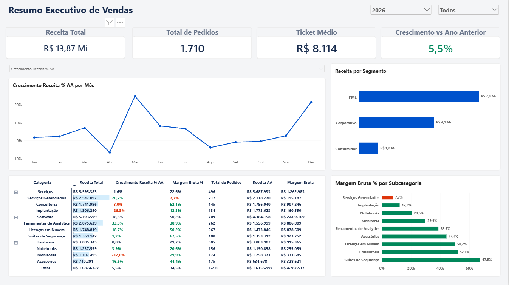
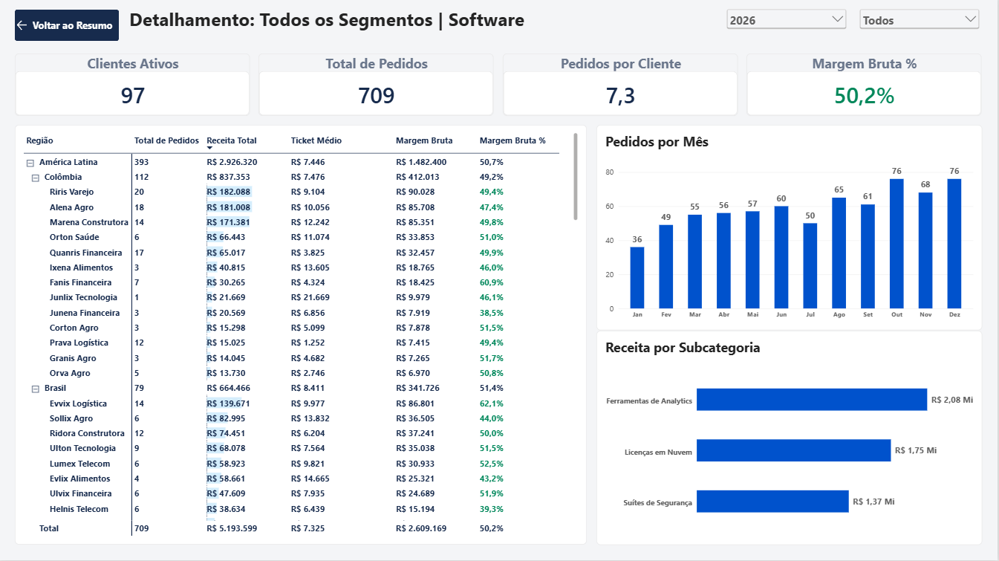
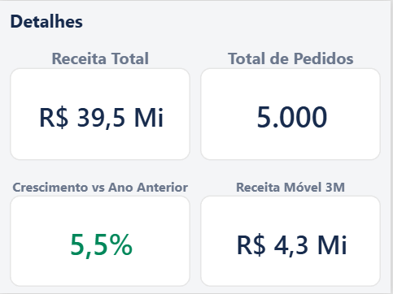
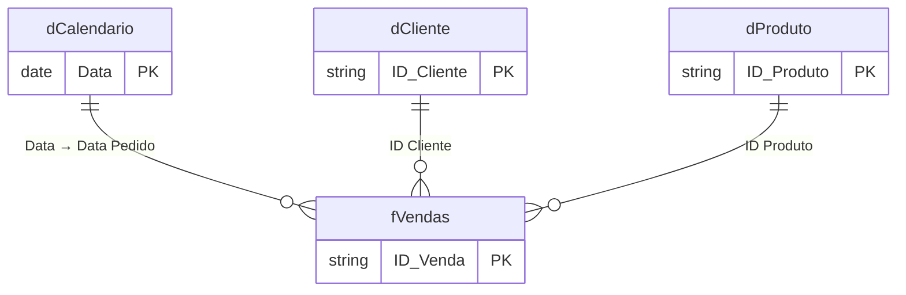

# Dashboard Executivo de Vendas · Power BI

Relatório executivo de vendas B2B de tecnologia (Hardware, Software e Serviços) com visão consolidada de receita, pedidos, ticket médio, margem e crescimento anual, mais um detalhamento por cliente acessado via *drill-through*.

O foco do projeto é **modelagem e DAX bem feitos**: modelo estrela, inteligência de tempo robusta, parâmetro de campo, formatação condicional orientada por medidas e navegação entre páginas.



## Páginas

| Página | O que mostra |
|---|---|
| **Resumo Executivo de Vendas** | KPIs com cor dinâmica, tendência mensal com seletor de métrica (pedidos, receita ou crescimento), receita por segmento, margem por subcategoria com meta de 10% e matriz Categoria › Subcategoria |
| **Detalhamento de Clientes e Pedidos** | Página de *drill-through* (botão direito em um segmento ou categoria): KPIs do recorte, matriz Região › País › Cliente, pedidos por mês e receita por subcategoria, com título dinâmico |
| **Tooltip Detalhes** | Tooltip de página exibido ao passar o mouse na tendência: receita, pedidos, crescimento e receita móvel de 3 meses |

<p>
  
  
</p>

## Modelo de dados



- **Esquema estrela** com relacionamentos 1:N de filtro único; colunas técnicas da fato ocultas e medidas centralizadas em `_Medidas`, organizadas em pastas.
- **`dCalendario` gerada no Power Query** a partir do intervalo de datas da fato (anos completos) e marcada como tabela de datas, com a flag `Período com Vendas` para a inteligência de tempo.
- **Parâmetro de campo** `Seletor de Métrica` para alternar a métrica do gráfico de tendência.
- Data/hora automática desativada e medidas implícitas desencorajadas.

## Destaques de DAX

**Crescimento vs. ano anterior, robusto a ano parcial e à ausência de filtro de ano:**

```dax
Receita AA =
CALCULATE(
    [Receita Total],
    CALCULATETABLE(
        SAMEPERIODLASTYEAR(dCalendario[Data]),
        dCalendario[Período com Vendas] = TRUE()
    )
)

Crescimento Receita % AA =
VAR _AnoRef = MAX(dCalendario[Ano])
VAR _ReceitaAtual = CALCULATE([Receita Total], dCalendario[Ano] = _AnoRef)
VAR _ReceitaAA = CALCULATE([Receita AA], dCalendario[Ano] = _AnoRef)
RETURN
    IF(
        NOT ISBLANK(_ReceitaAtual) && NOT ISBLANK(_ReceitaAA),
        DIVIDE(_ReceitaAtual - _ReceitaAA, _ReceitaAA)
    )
```

Também usados no projeto:
- **Receita móvel de 3 meses** com `DATESINPERIOD`, limitada à data da última venda.
- **Cores dinâmicas** (`Cor Status KPI`, `Cor Faixa Margem`) aplicadas via formatação condicional por campo.
- **Títulos dinâmicos** que reagem ao seletor de métrica e ao contexto do *drill-through*.
- **Boas práticas gerais:** variáveis, `DIVIDE`, `SELECTEDVALUE` com valor alternativo e descrição em todas as medidas.

## Power Query (M)

- Parâmetro `PastaDados` e função reutilizável `fnLerCsv` (UTF-8, `QuoteStyle.Csv`, cabeçalho promovido) no lugar de caminhos fixos por consulta.
- Tipagem com cultura explícita (`"en-US"`) para não depender das configurações regionais da máquina.
- Valores monetários como decimal fixo (`Currency.Type`).

## Dados

Os dados são **100% sintéticos**, gerados por [`scripts/gerar_dados.py`](scripts/gerar_dados.py) com semente fixa, ou seja, sempre o mesmo resultado. São 100 clientes fictícios, 27 produtos e 5.000 vendas entre 2024 e 2026, com:
- sazonalidade (pico no 4º trimestre);
- tendência diferente por subcategoria;
- preço ligado ao custo do produto, com reajuste anual;
- desconto variando conforme o segmento do cliente;
- concentração de receita em poucos clientes.

## Como abrir

1. **Pré-requisitos:** Power BI Desktop com suporte a PBIP (TMDL + PBIR) e Python 3.10+ (opcional, só para regerar os dados).
2. **(Opcional) Regere os CSVs:** `python scripts/gerar_dados.py`.
3. **Abra o projeto:** abra `dashboard_executivo.pbip` no Power BI Desktop.
4. **Aponte para os dados:** em *Transformar dados › Gerenciar parâmetros*, ajuste `PastaDados` para a pasta `data\` do seu clone (terminando com `\`).
5. **Atualize:** clique em *Atualizar*.

## Estrutura

```
dashboard_executivo.pbip               # ponto de entrada do Power BI Desktop
dashboard_executivo.SemanticModel/     # modelo em TMDL (tabelas, medidas, relacionamentos, Power Query)
dashboard_executivo.Report/            # relatório em PBIR (páginas e visuais em JSON)
data/                                  # CSVs sintéticos
scripts/gerar_dados.py                 # gerador dos dados
imgs/                                  # capturas de tela
```

---

Desenvolvido por **Mateus Vieira** · Power BI · DAX · Power Query
